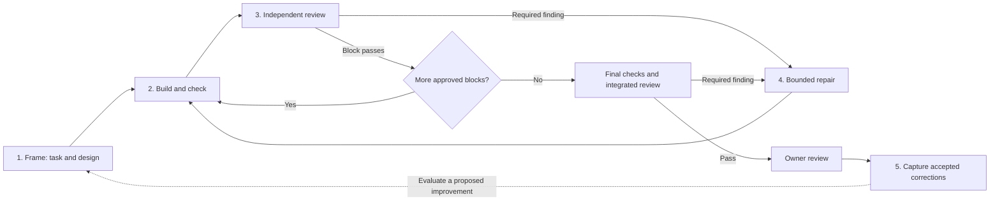

# Workflow guide

**Start here.** Agent Workflow gives Claude a work process and a small helper that records whether the work passed. Claude Code Desktop supplies the agents and continuation. You choose the outcome and review the result.

Start with a supervised block, then a longer approved queue. Local tests cover the helper. They do not establish model quality or uninterrupted overnight execution. See [design and limits](DESIGN.md) for the implementation choices and remaining limits.

## First run

1. Open the target repository in Claude Code Desktop, using the account and billing mode authorized for the work.
2. Paste the [launch prompt](../templates/LAUNCH.md). Supply the absolute workflow path, actual checkout and desired outcome. Ask for one useful block first. Claude prepares the files and runs the helper; you do not need to hand-write JSON.
3. Review the short task, responsibility sketch, pattern links and acceptance examples. Approve the concrete scope and actions. Routine choices inside that scope do not require repeated approval.
4. Watch one complete build, check, independent review and final gate. Open the served review link. Try a code link, save a note and return to the page.
5. Extend the next queue only when that result is useful. For a long run, qualify the actual host's goal, permissions, reset waiting and device/service checks using the [overnight guide](OVERNIGHT.md). Set fresh absolute deadlines.

No installation of global skills or hooks is required. Node 24.12+ and Git are required. For harness development, `npm ci` followed by `npm run check` runs type checking and tests. Runtime use does not need `node_modules`.

## The five steps

| Step | What Claude does | What you review |
|---|---|---|
| **1. Frame** | Reads actual code and rules. Names the caller, state/policy owners, reused patterns and acceptance checks. Splits larger work into verifiable blocks. | `TASK.md`, a small diagram and links to existing patterns. `NATIVE.json` records scope, dependencies and deadlines. |
| **2. Build** | One builder owns the checkout. The helper runs the configured project checks on quiet source and saves results plus a source snapshot. | Observable behavior, relevant tests and check logs. A passing build is only one part of acceptance. |
| **3. Review** | A fresh reviewer checks both Standards and Spec, including material architecture/readability issues. Required findings have stable IDs and locations. | The summary, a few important code links, required findings and missing evidence. |
| **4. Repair** | Fixes required findings, reruns checks and obtains independent closure. Defaults: two repair passes and 45 minutes per block, within the run deadlines. | What changed after review, what was closed and what remains. A new reviewer or resumed session does not reset the budget. |
| **5. Learn** | Captures your criticism and selected code before correction. Saves the accepted correction only after you accept it. Exports examples for evaluation. | Your own words, the before/after code and a proposed lesson. No permanent rule changes automatically. |

The first two loops improve a task. The last loop improves future work. Grouping lessons, judging them and promoting a rule still require agent/human work; there is no automatic gardener service.

## What the helper enforces

| Enforced when the helper runs | Still depends on Claude, the host or you |
|---|---|
| Explicit project configuration and approval bound to current inputs | Choosing useful scope, good architecture and meaningful tests |
| One active writing block per run, dependencies and allowed paths | Keeping different runs out of the same checkout and stopping actual workers |
| Required commands, exit codes, logs and source identity | UI interactions, external state and freshness of ignored build output |
| A different recorded reviewer identity from all builders | Actually dispatching a fresh reviewer with read-only access |
| Required findings persist until explicit closure; missing verification blocks acceptance | Whether the reviewer finds the right issues and whether its evidence is truthful |
| Shared repair counters, time limits and final-source acceptance | Keeping the Desktop session alive and within the intended billing mode |

These are workflow checks, not a security boundary against an agent that edits state or ignores the helper. Frozen runtime copies keep upgrades out of active runs. There are no global hooks enforcing this process across unrelated sessions.

## The page you come back to

Open the URL returned by `serve`, not an editable preview of static HTML. The lead should leave the URL and restart command in its handoff.

Read it in this order:

1. **Outcome and attention items:** what works, what is blocked and actual decisions needed.
2. **Design and read-first links:** the owners of important behavior and the few files worth inspecting.
3. **Try it:** exercise the stated demonstration. Screenshots alone do not prove an interaction worked.
4. **Evidence:** final combined-source checks and review. Earlier block checks may be historical after later edits.
5. **Notes:** save feedback or use your normal Claude conversation. Notes have version checks and backup copies; they are not part of generated report content.

`PRESENTATION.json` lets the lead add a short outcome, specific code links, design pointers and a demonstration. Without it, the page falls back to the review summary and changed-file list. Full logs and review records stay behind links.

Static `REVIEW.html` is a read-only fallback. `REVIEW.md` and `NOTES.md` are normal files. The local viewer saves reading position and expanded sections as well as notes. It binds to localhost and makes no model calls.

## Feature, port or refactor

| Work | Plan around | Prove before acceptance |
|---|---|---|
| Feature | One complete user outcome through the necessary layers | Success, failure, empty states and relevant side effects |
| Port | One working journey, an explicit parity list and allowed differences | The new stack preserves required behavior; real device/UI interactions where needed |
| Refactor | A clear ownership/interface improvement and behavior that must remain stable | Existing behavior, affected callers and deletion of superseded code |

For a broad API change, use expand, migrate, then remove the old form. If intermediate blocks cannot pass the project gate, combine the coupled work or keep it supervised. More agents do not resolve a shared-file dependency.

## What exists in this repo

| Part | Why it exists |
|---|---|
| [Seven skills](../skills/ADAPTATIONS.md) | `to-spec`, `to-tickets`, `codebase-design`, `implement`, `tdd`, `code-review` and `orchestrate`. Six are pinned Matt Pocock adaptations; orchestration is local. |
| [harness.ts](../harness.ts) | One command entry point. Native actions, review viewer, feedback and eval commands share it. |
| [native.ts](../lib/native.ts), [quality.ts](../lib/quality.ts), [checks.ts](../lib/checks.ts) | The state transitions, acceptance rules and bounded command execution. These make the loops more than prompt instructions. |
| [report.ts](../lib/report.ts), [review-page.ts](../lib/review-page.ts), [review-server.ts](../lib/review-server.ts) | The review summary, visual page, code links and durable notes. |
| [feedback.ts](../lib/feedback.ts) and [evals](../evals/README.md) | Selected correction capture, export, small executable exercises and summaries of human labels. |
| [Templates](../templates/LAUNCH.md) | Launch prompt, task brief, project settings and separate native/CLI run formats. |
| [Optional preferences](../examples/preferences/readable-code/STYLE.md) | Example comment/readability checks. Personal taste is opt-in, not shared default policy. |
| [runner.ts](../lib/runner.ts) and [claude.ts](../lib/claude.ts) | Optional CLI execution in private clones. It invokes Claude and has different account and permission behavior. Use native mode for a Desktop session. |
| [Tests](../test/native.test.ts) | Regression coverage of the workflow machinery. Fixtures use scripted model responses; they do not measure model judgment. |

There is no global installer, hook pack, project profile, automatic multi-model tournament or automatic rule-promotion service. Application paths, commands, service permissions and architecture rules belong in the project's run configuration. Private inputs stay outside this repo or in ignored `.local/`.

## What the evals can tell you

**Implemented:** six small behavior exercises, optional readability exercises, feedback export and summaries of human-labeled reviewer/trial outcomes.

**Not implemented:** automatic reviewer benchmarking, a calibrated held-out corpus or an end-to-end harness comparison runner. Passing harness tests does not show that the code it generates meets your standards.

For the first real tasks, record four things: correctness, first-pass acceptance, minutes you spent reviewing/fixing, and repeated architecture complaints. Keep the first implementation separate from the repaired result. Start calibration with 5-10 real rejected examples plus acceptable controls. A human matches reviewer findings to important issues and marks false blockers. Keep expected findings outside reviewer access. See the [evaluation procedure](../evals/README.md).

The next useful addition is a small set of your labeled examples, followed by a benchmark runner if manual comparison becomes a burden. Another reviewer, hook or skill should earn its place by reducing missed issues or your cleanup time.

For exact agent commands, use [NATIVE.md](NATIVE.md). For implementation choices and upstream comparisons, use [design and limits](DESIGN.md).
